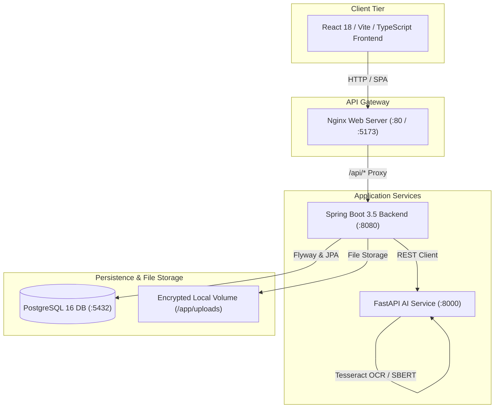

# EXAMIND — AI-Powered Examination & Evaluation System

> **Evaluate. Understand. Improve.**  
> A production-grade, human-in-the-loop automated examination and pedagogical assessment platform combining dense vector semantic evaluation, computer vision OCR, explainable scoring, teacher override audits, and institutional analytics.

---

## 🚀 Key Capabilities

- **Role-Based Authentication (RBAC)**: Secure registration, login, token refresh, and logout for `STUDENT`, `TEACHER`, and `ADMIN`.
- **Descriptive Exam Authoring**: Creation of exams, descriptive questions, and multi-criteria rubrics with expected concepts.
- **Multimodal Student Submissions**: Real-time autosaved typing interface and scan/PDF upload with MIME and magic byte verification.
- **Computer Vision & OCR Pipeline**: Two-stage PDF processing (instant digital extraction or rasterized scan OCR), image deskewing, CLAHE contrast enhancement, and Tesseract engine integration.
- **Explainable AI Evaluation**: Dense semantic similarity (`sentence-transformers/all-MiniLM-L6-v2`), concept detection, rubric breakdown, strengths, weaknesses, and targeted feedback.
- **Human-in-the-Loop Review**: Multi-factor confidence scoring; low confidence flags submissions for mandatory teacher review (`REVIEW_REQUIRED`).
- **Immutable Evaluation Versioning**: Every teacher score override preserves the original AI evaluation (V1) and logs reasons and timestamps in audit history.
- **Academic Integrity & Similarity**: Non-accusatory cross-student answer correlation ("Potentially Similar") with word-level Jaccard indexing.
- **Student Insights & Analytics**: Strong/weak topic breakdown, revision recommendations, score distributions, and teacher override rate analytics.

---

## 🛠️ Technology Stack

| Layer | Technologies |
|---|---|
| **Frontend** | React 18, TypeScript 5.6, Vite 6, Tailwind CSS, TanStack React Query, React Router v6, Recharts, Lucide Icons |
| **Backend Core** | Java 21 / 25, Spring Boot 3.5.16, Spring Security 6, Spring Data JPA, JJWT 0.12.6, Spring Boot Actuator |
| **AI / OCR Engine** | Python 3.11, FastAPI, Uvicorn, PyTorch, Sentence Transformers, Tesseract OCR, PIL/Pillow, pypdf |
| **Persistence** | PostgreSQL 16 (Production) with Flyway migrations (`V1__initial_schema.sql`), In-Memory H2 (Dev/Testing) |
| **Infrastructure** | Docker, Docker Compose, Multi-stage Dockerfiles, Nginx Alpine, GitHub Actions CI/CD |

---

## 🏗️ System Architecture



---

## ⚡ Quickstart

### 1. Docker Compose (Full Stack)
```bash
# 1. Clone repository and copy environment template
cp .env.example .env

# 2. Build and start containers
docker compose up -d --build

# 3. Access services
# Frontend: http://localhost:5173
# Backend Swagger: http://localhost:8080/swagger-ui.html
# AI Service Health: http://localhost:8000/health
```

### 2. Local Development Without Docker

#### Backend
```powershell
.\mvnw.cmd clean spring-boot:run
```
*(Runs on port 8080 using in-memory H2 database by default)*

#### AI Service
```powershell
cd ai-service
python -m uvicorn app.main:app --host 0.0.0.0 --port 8000 --reload
```

#### Frontend
```powershell
cd frontend
pnpm install
pnpm run dev
```

---

## 🧪 Verification & Automated Test Suites

All test suites have been verified with 100% pass rates:

### 1. Backend Integration Tests (19/19 Passing)
```powershell
.\mvnw.cmd clean test
```
*Tests cover: JWT registration & login, refresh token rotation, logout revocation, blocked user rejection, complete exam lifecycle, question & rubric creation, autosave & submit, asynchronous AI evaluation, teacher score overrides with version history, student results, student insights & performance, teacher exam ownership isolation, student submission isolation, malicious file upload rejection, and word-level similarity detection.*

### 2. AI Service & OCR Tests (41/41 Passing)
```powershell
pytest
```
*Tests cover: OCR PNG/JPG document extraction, PDF parsing, empty file rejection, chained OCR-to-evaluation pipeline, benchmark grading (correct, partial, blank, misconception, paraphrase), confidence calibration, rubric criteria calculation, and LLM fallback abstractions.*

### 3. Frontend Tests & Build (13/13 Passing)
```powershell
cd frontend
pnpm test
pnpm run build
```
*Tests cover: exam timer countdown, autosave status indicator, question palette navigation, date/grade utility formatting, and full TypeScript production bundling.*

---

## 📚 Detailed Documentation

- [System Architecture](docs/ARCHITECTURE.md)
- [REST API Specification](docs/API.md)
- [Production Deployment Guide](docs/DEPLOYMENT.md)
- [Security Architecture & Threat Model](docs/SECURITY.md)
- [Production Readiness Audit](docs/PRODUCTION_READINESS.md)
- [Full System Audit Log](docs/SYSTEM_AUDIT.md)
