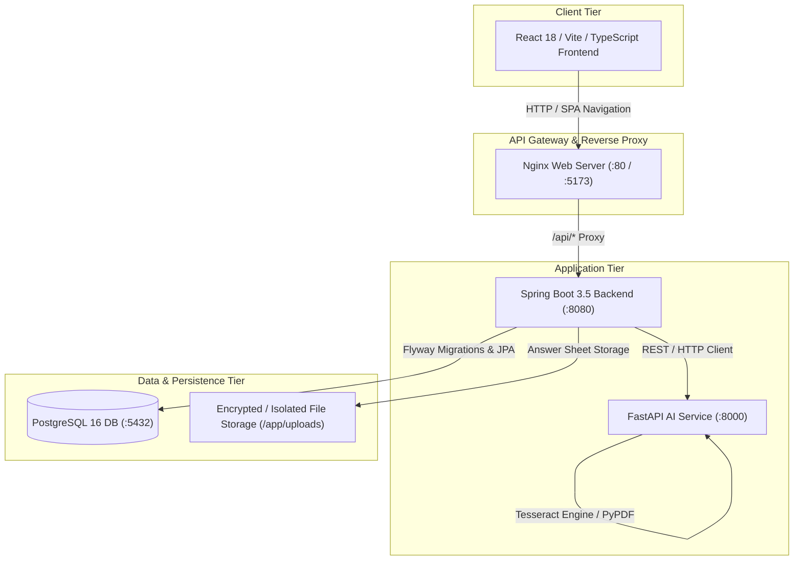
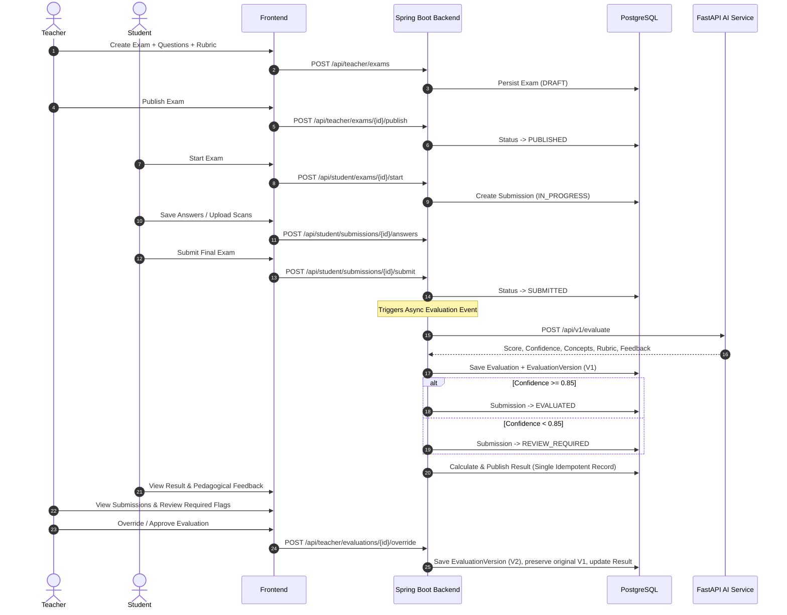

# EXAMIND — System Architecture Specification

## 1. Executive Overview

EXAMIND is an AI-powered automated examination and evaluation platform designed for modern higher education and enterprise certification. It provides end-to-end support for the examination lifecycle: exam authoring, descriptive question authoring, multi-criteria rubric definition, secure student submission (online typing or scanned document upload), hybrid OCR/document processing, multi-dimensional AI scoring, human-in-the-loop teacher review with versioned audits, and institutional analytics.

---

## 2. Core Subsystems

### 2.1 Backend Core (Spring Boot 3.5 / Java 25 & 21)
- **Framework**: Spring Boot 3.5.16, Spring Data JPA, Spring Security 6.
- **Authentication & RBAC**: Stateless JWT (JJWT 0.12.6) with HMAC-SHA256, rotating refresh tokens with database persistence, and role-based access control (`ROLE_STUDENT`, `ROLE_TEACHER`, `ROLE_ADMIN`).
- **Data Persistence**: PostgreSQL 16 (production) with Flyway database migrations (`V1__initial_schema.sql`). In-memory H2 with PostgreSQL dialect compatibility for isolated testing.
- **Auditing & Correlation**: `MdcLoggingFilter` injects `X-Request-ID` into Logback MDC context and HTTP response headers for end-to-end request tracing.
- **Monitoring**: Spring Boot Actuator with `/actuator/health`, `/actuator/info`, and `/actuator/metrics`.

### 2.2 AI & Document Processing Engine (Python 3.11 / FastAPI)
- **Framework**: FastAPI with asynchronous endpoints (`uvicorn app.main:app`).
- **OCR Subsystem**:
  - `TesseractOCRProvider`: Production OCR engine with auto-discovery of system binaries across Linux/Windows/macOS.
  - Image Preprocessor: Grayscale conversion, CLAHE adaptive contrast enhancement, Sauvola/Otsu binarization, rotation/deskew normalization.
  - Two-Stage PDF Handling: Extracts native digital text directly via `pypdf`/`pypdfium2` when available; rasterizes scanned pages to images for OCR only when necessary.
  - `MockOCRProvider`: Test harness for deterministic testing and non-Tesseract environments.
- **Evaluation Pipeline**:
  - Semantic Similarity: `sentence-transformers/all-MiniLM-L6-v2` dense vector embeddings.
  - Concept Detection: Keyphrase extraction, coverage calculation, and missing concept detection.
  - Rubric Scoring: Criterion-by-criterion weighting and marks allocation.
  - Confidence Scoring: Multi-factor Bayesian-style confidence assessment flagging low-confidence or anomalous evaluations for human review (`requiresReview = true`).

### 2.3 Single-Page Frontend (React 18 / TypeScript / Vite)
- **Framework**: React 18 with TypeScript 5.6 and Vite 6.
- **Styling**: Tailwind CSS with responsive layout design.
- **State & Data Fetching**: TanStack React Query v5 for server-state caching and synchronization; React Hook Form with Zod validation.
- **Data Visualization**: Recharts for performance distributions, topic mastery radar/bar charts, and AI vs human evaluation differences.
- **Routing**: React Router DOM v6 with role-based protected route guards.

---

## 3. End-to-End Data & Evaluation Flow

---

## 4. Academic Integrity & Similarity Detection

1. **Similarity Scoring**: Word-level Jaccard indexing comparing submitted answers across all students within the same question.
2. **Pedagogical Terminology**: Status is classified as `HIGH_SIMILARITY` or `NORMAL`. The system labels results as **"Potentially Similar"**, explicitly avoiding accusatory terminology such as "cheater". The final determination rests solely with the instructor.
3. **Audit Trail**: Every teacher modification creates an immutable `EvaluationVersion` with teacher identifier, timestamp, revised score, and mandatory justification reason.

